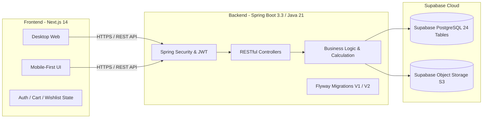

# SPORTCYCLE – Multi-Sport E-Commerce Marketplace
> **Gear. Play. Repeat.**

SPORTCYCLE is an enterprise-grade multi-sport e-commerce marketplace and sports community platform. Built for athletes, sports clubs, and enthusiasts, SPORTCYCLE enables customers to discover, purchase, and sell both brand-new and certified pre-owned sports equipment across 12 athletic disciplines.

---

## 🎨 Brand Identity & Design System

SPORTCYCLE features a clean, high-contrast, editorial sports retail identity optimized for mobile-first shopping:

| Token | Hex Color | Usage |
|---|---|---|
| **Primary Lime** | `#B8D94B` | Primary CTAs, active badges, highlights |
| **Ivory Background** | `#F8F9E9` | Page body background, soft panels |
| **Pure White** | `#FFFFFF` | Cards, elevated surfaces, clean product canvases |
| **Olive Green** | `#52642A` | Brand headers, active navigation, category pill selections |
| **Dark Readable Text** | `#26321A` | High-contrast typography, product titles |
| **Light Grey** | `#F3F4F6` | Secondary tags, search bars, table headers |
| **Border** | `#E5E7EB` | Subtle structural dividers |

---

## 🏗️ Architecture Overview

The platform is structured as a production-ready monorepo strictly adhering to zero direct database access from the client:



- **Frontend:** Next.js 14 (App Router), TypeScript, Tailwind CSS, Lucide React.
- **Backend:** Java 21, Spring Boot 3.3.5, Spring Data JPA / Hibernate, Spring Security + JJWT 0.12.6, Flyway, Springdoc OpenAPI 2.6.0.
- **Database:** Supabase PostgreSQL with 24 relational tables, full foreign keys, and indexes.
- **Storage:** Supabase Storage (S3-compatible bucket `sportcycle-products`).
- **Payment Gateway:** Razorpay order creation and HMAC-SHA256 signature verification.
- **Deployment:** Railway Docker containerization for both services.

---

## 📂 Monorepo Structure

```text
sport-cycle/
├── backend/                             # Java 21 Spring Boot Backend
│   ├── src/main/java/com/sportcycle/
│   │   ├── config/                      # OpenAPI & App Configuration
│   │   ├── controller/                  # 16 REST Controllers
│   │   ├── dto/                         # Request & Response Data Transfer Objects
│   │   ├── entity/                      # 23 JPA Entities & Enums
│   │   ├── exception/                   # GlobalExceptionHandler & Domain Exceptions
│   │   ├── repository/                  # Spring Data JPA Repositories
│   │   ├── security/                    # JWT Filter, Token Provider, UserPrincipal
│   │   └── service/                     # 15 Business & Storage Services
│   ├── src/main/resources/
│   │   ├── db/migration/
│   │   │   ├── V1__initial_schema.sql   # 24 Relational Tables DDL
│   │   │   └── V2__seed_data.sql        # Seed Users, Sports, Categories, Products
│   │   ├── application.properties       # Base Spring Boot Configuration
│   │   └── application-prod.properties  # Production Supabase Configuration
│   ├── src/test/java/                   # Unit & Integration Tests (JUnit 5 + Mockito)
│   ├── pom.xml                          # Maven Dependencies
│   ├── Dockerfile                       # Multi-stage Eclipse Temurin 21 Alpine
│   └── .env.example                     # Environment Variables Template
│
├── frontend/                            # Next.js 14 App Router Frontend
│   ├── src/
│   │   ├── app/                         # 19 Next.js App Router Pages
│   │   │   ├── page.tsx                 # 13-Section Editorial Homepage
│   │   │   ├── products/                # Search, Multi-Filter, Pagination
│   │   │   ├── pre-owned/               # Certified Pre-Owned Gear Directory
│   │   │   ├── sports/                  # 12 Sports & Subcategories
│   │   │   ├── cart/                    # Shopping Cart with Price Calculation
│   │   │   ├── wishlist/                # Saved Gear
│   │   │   ├── checkout/                # Multi-Step Address & Payment
│   │   │   ├── orders/                  # Orders & Visual Tracking Timeline
│   │   │   ├── seller/                  # Seller Onboarding & Listing Creator
│   │   │   ├── clubs/                   # Sports Clubs Marketplace & Inquiries
│   │   │   ├── profile/                 # Profile & Address Manager
│   │   │   ├── notifications/           # In-App Notification Center
│   │   │   ├── admin/                   # Full Admin Moderation & Orders Dashboard
│   │   │   └── auth/                    # Login & Register with Demo Credential Fill
│   │   ├── components/                  # Design System Components
│   │   ├── context/                     # Auth, Cart, and Wishlist React Contexts
│   │   └── lib/                         # API Client & Mock Seed Engine
│   ├── tailwind.config.ts               # Exact Brand Color Tokens
│   ├── package.json                     # Next 14, React 18, Lucide React
│   ├── Dockerfile                       # Multi-stage Node 20 Runner
│   └── .env.example                     # Frontend Environment Variables Template
│
├── docs/                                # Technical Documentation
│   ├── ARCHITECTURE.md                  # Comprehensive System Architecture
│   ├── API_DOCUMENTATION.md             # Complete REST API & Swagger Specs
│   ├── SUPABASE_SETUP.md                # PostgreSQL DDL & Storage Setup Guide
│   └── RAILWAY_DEPLOYMENT.md            # Railway Production Deployment Guide
│
├── railway.json                         # Railway Multi-Service Blueprint
└── README.md                            # Main Project README
```

---

## ⚡ 20-Phase Implementation Matrix

| Phase | Description | Status | Key Deliverables |
|---|---|---|---|
| **01** | Complete Project Foundation & Architecture | ✅ Completed | Monorepo layout, Java 21 Spring Boot, Next.js 14, OpenAPI 3.0 |
| **02** | Design System & Brand Identity | ✅ Completed | Tailwind palette (`#B8D94B`, `#F8F9E9`, `#52642A`), typography |
| **03** | Mobile-First Responsive Foundation | ✅ Completed | Sticky nav, bottom nav, filter drawer, loading skeletons |
| **04** | Homepage & Landing Experience | ✅ Completed | 13 homepage sections: Hero, Sports, Trending, Clubs, Newsletter |
| **05** | Sports Categories & Discovery | ✅ Completed | 12 sports catalog, subcategories, brand & condition facets |
| **06** | Product Listing & Advanced Search | ✅ Completed | Multi-filter, debounced search, sorting, pagination |
| **07** | Product Details Page | ✅ Completed | Zoom gallery, specifications, wear description, sticky purchase bar |
| **08** | New & Pre-Owned Equipment Marketplace | ✅ Completed | 5 condition tiers, verification badge workflow, usage metadata |
| **09** | User Authentication & Profile Management | ✅ Completed | Spring Security, JJWT, BCrypt, 4 RBAC roles, address manager |
| **10** | Shopping Cart & Wishlist | ✅ Completed | Persistent user carts, guest cart merge, server price recomputation |
| **11** | Checkout & Payment Gateway Integration | ✅ Completed | Multi-step checkout, Razorpay order creation & HMAC verification |
| **12** | Order Management & Tracking | ✅ Completed | Order status history, 5-stage visual progress timeline, cancel order |
| **13** | Seller Dashboard & Listings | ✅ Completed | Seller stats, listing creation (New/Used), pause/activate listing |
| **14** | Sports Club Marketplace | ✅ Completed | Club directory, public showcase, membership inquiry workflows |
| **15** | Reviews, Ratings & Notifications | ✅ Completed | Verified purchase reviews, star ratings, in-app notification center |
| **16** | Complete Admin Dashboard | ✅ Completed | KPI metrics, pre-owned product moderation, order overrides, audit logs |
| **17** | Supabase Database & Storage Design | ✅ Completed | Flyway `V1__initial_schema.sql` (24 tables), `V2__seed_data.sql` |
| **18** | Security, Performance & Unit Testing | ✅ Completed | JUnit 5 + Mockito test suites, BCrypt hashing, CORS, rate limits |
| **19** | Railway Deployment & Supabase Setup | ✅ Completed | Dockerfiles, `railway.json`, Supabase production guides |
| **20** | Final UI Polish & Launch Package | ✅ Completed | Documentation pack, demo accounts, verification checklists |

---

## 🚀 Quick Start Guide

### Prerequisites
- **Java 21** (`java -version`)
- **Maven 3.9+** (`mvn -v`)
- **Node.js 20+** and **npm** (`node -v`, `npm -v`)
- *(Optional for Prod)* Supabase Account & Railway Account

---

### 1. Running the Spring Boot Backend

The backend runs on port `8080` by default. For local development, an in-memory H2 database with the full seed catalog is automatically enabled if no external PostgreSQL database is supplied.

```bash
cd backend

# Run automated tests
mvn test

# Start the Spring Boot Application
mvn spring-boot:run
```

Once running:
- **API Base URL:** `http://localhost:8080/api/v1`
- **Interactive Swagger UI:** `http://localhost:8080/swagger-ui.html`
- **OpenAPI Schema:** `http://localhost:8080/v3/api-docs`
- **H2 Console (Dev):** `http://localhost:8080/h2-console` (JDBC URL: `jdbc:h2:mem:sportcycledb`, user: `sa`, password: *(blank)*)

---

### 2. Running the Next.js Frontend

The frontend runs on port `3000` by default.

```bash
cd frontend

# Install dependencies
npm install

# Start Next.js development server
npm run dev

# Or test production build
npm run build
npm start
```

Open `http://localhost:3000` in your browser. The application includes a fallback mock engine so the UI is fully interactive even before the backend is booted.

---

## 🔑 Demo User Accounts

The database seed migration (`V2__seed_data.sql`) installs ready-to-test accounts. In the frontend login page (`/auth/login`), 1-click credential buttons are provided:

| Role | Email Address | Password | Permissions & Views |
|---|---|---|---|
| **Platform Admin** | `admin@sportcycle.com` | `password123` | Full Admin Dashboard (`/admin`), Moderation, Audit Logs |
| **Equipment Seller** | `seller@sportcycle.com` | `password123` | Seller Dashboard (`/seller`), Listing Creation |
| **Club Admin** | `club@sportcycle.com` | `password123` | Sports Club Administration (`/clubs/admin`) |
| **Customer** | `customer@sportcycle.com` | `password123` | Shopping, Wishlist, Checkout, Orders, Reviews |

---

## 🧪 Testing & Verification

### Backend Tests
The backend test suite validates authentication token generation, password encryption, cart price recalculation, and stock validation:

```bash
cd backend
mvn test
```

### Frontend Build Verification
The frontend passes strict TypeScript and Next.js static prerender checks:

```bash
cd frontend
npm run build
```

---

## 🚢 Production Deployment

Detailed step-by-step guides are located in the `docs/` directory:
- [System Architecture](docs/ARCHITECTURE.md)
- [REST API Documentation](docs/API_DOCUMENTATION.md)
- [Supabase Setup Guide](docs/SUPABASE_SETUP.md)
- [Railway Deployment Guide](docs/RAILWAY_DEPLOYMENT.md)

---

## 🛡️ License & Copyright
SPORTCYCLE © 2026. Built with precision for athletes worldwide.

